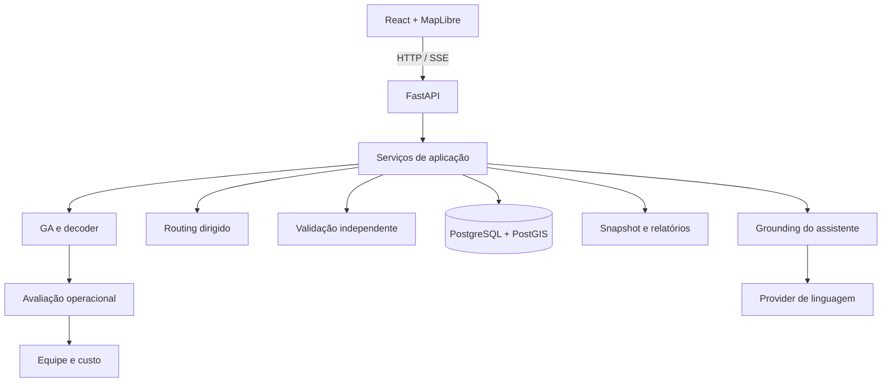

# FluxMed — arquitetura

## Componentes

O projeto é um monorepo com frontend React/TypeScript e backend FastAPI. As regras operacionais são organizadas em módulos de aplicação, domínio, routing, otimização, relatórios e LLM. PostgreSQL/PostGIS mantém operações, recursos, resultados e geometrias.

## Organização do código

| Local | Responsabilidade |
|---|---|
| `apps/web/src/app/` | Rotas, autenticação de navegação e estrutura visual. |
| `apps/web/src/features/` | Operações, entregas, recursos, resultados, relatórios e assistente. |
| `apps/web/src/services/` | Clientes HTTP tipados. |
| `apps/api/src/fluxmed/api/v1/` | Routers e schemas HTTP. |
| `apps/api/src/fluxmed/application/` | Casos de uso e transações. |
| `apps/api/src/fluxmed/domain/` | Tipos e regras de domínio. |
| `apps/api/src/fluxmed/optimization/` | Representação, operadores, decoder, fitness e evolução. |
| `apps/api/src/fluxmed/routing/` e `city/` | Grafo dirigido, caminhos, trânsito e geração da cidade. |
| `apps/api/src/fluxmed/infrastructure/` | ORM, repositórios e sessões. |
| `apps/api/src/fluxmed/llm/` | Contrato e implementação dos providers. |

## Fluxo da otimização

1. A aplicação carrega e valida entregas, recursos, fuso e janela da operação.
2. O routing constrói a matriz entre endereços.
3. O GA evolui permutações; o decoder atribui veículos e forma rotas.
4. `OperationalFitnessEvaluator` aplica o matching de equipe e o motor de custo a cada candidato.
5. `SolutionValidator` reconstrói as restrições a partir das entradas originais.
6. A aplicação atribui a equipe final, calcula custos com as mesmas regras e persiste o resultado validado e os eventos finais na transação de conclusão.

O núcleo admite avaliador e callbacks injetados. A aplicação adapta os recursos persistidos para o núcleo e responde pela coordenação, pelo custo operacional e pela persistência.

## Routing e referência temporal

Routing determina caminhos no grafo dirigido entre endereços. O GA trabalha sobre entregas. Cada par da matriz e sua geometria usam o horário inicial da operação como referência de partida; dentro do caminho, as arestas recebem fatores de trânsito pelo horário estimado de entrada.

O decoder constrói a cronologia com os tempos da matriz, serviço e espera. [SANTA_AURORA_SPEC.md](SANTA_AURORA_SPEC.md) descreve os fatores e as unidades.

## Execução e progresso

`OptimizationRunCoordinator` usa `ThreadPoolExecutor`, com dois workers por padrão, no processo da API. O run é persistido antes da submissão, e o worker usa sua própria sessão de banco.

Estados, eventos, cancelamento, reconexão SSE e replay estão descritos em [OPTIMIZATION_TRACE.md](OPTIMIZATION_TRACE.md). A inicialização identifica runs deixados ativos por encerramento do processo como `INTERRUPTED`.

## Persistência e relatórios

Runs e rotas mantêm seus vínculos com a operação/revisão. Aprovação e despacho são transições verificadas pelo backend. Relatórios guardam um snapshot e os bytes do artefato; o download reproduz o conteúdo persistido.

Campos, nulabilidade e relações estão em [DOMAIN_MODEL.md](DOMAIN_MODEL.md). Os schemas HTTP estão em [API_SPEC.md](API_SPEC.md).

## Assistente e credenciais

O assistente recupera contexto por ferramentas autorizadas antes da redação pelo provider. As chaves ficam no backend. A interface recebe resposta e metadados de fonte/provider; consultas e simulações respeitam a operação selecionada. [LLM_IMPLEMENTATION.md](LLM_IMPLEMENTATION.md) detalha esse fluxo.

## Ambiente local

O [Docker Compose](../docker-compose.yml) executa banco PostGIS, inicialização com migrações/seed, API e frontend. As portas são publicadas em loopback. A API local usa um único processo, compatível com o coordenador em memória.

Consulte [LOCAL_SETUP.md](LOCAL_SETUP.md) para instalação e diagnóstico e [TESTING_STRATEGY.md](TESTING_STRATEGY.md) para verificações.
